## À propos

Étudiant en Master Informatique, parcours Intelligence Artificielle à Avignon Université (2024-2026), basé à Toulon.
Je travaille sur la data science et la vision par ordinateur, et je suis à la recherche d'un CDI dans ces domaines.

Côté outils, j'aime aussi automatiser : pipelines GitLab CI/CD, conteneurs Docker, gestion de dépôts git.

## Technos

  

## Projets publics

| Projet | Description |
|---|---|
| [URLClicker](https://github.com/EmericDavid/URLClicker) | Addon World of Warcraft (Lua) qui rend les URL cliquables dans le chat. Licence MIT. |
| [VantusRuneHelper](https://github.com/EmericDavid/VantusRuneHelper) | Addon World of Warcraft (Lua) pour les runes de Vantus. |
| [deej-display-5641AS](https://github.com/EmericDavid/deej-display-5641AS) | Fork de deej, un mixeur audio matériel (Arduino et Go) avec de vrais curseurs. |

Mes projets d'IA et de data science sont pour l'instant dans des dépôts privés. Je peux en présenter le contenu sur demande.

## Contact

<!-- Ajoute ici ton lien LinkedIn, par exemple : [LinkedIn](https://www.linkedin.com/in/...) -->
